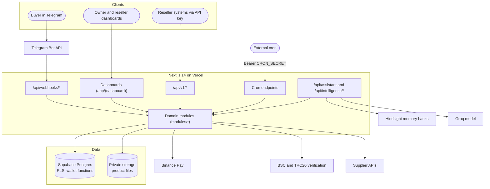

# AfterBuy Architecture

Technical reference for AfterBuy, the Telegram store that remembers every buyer.
See also: [README.md](./README.md), [docs/master-plan.md](./docs/master-plan.md), [docs/decisions.md](./docs/decisions.md).

## Goals

Every design choice serves one of four properties:

1. **Tenant isolation.** One reseller never sees another reseller's data, bots or memory.
2. **Correct money.** Amounts are integers, balances cannot go negative, and history is immutable.
3. **Reliable fulfilment.** Delivery runs on scheduled jobs and is safe to retry.
4. **Secrets stay on the server.** Tokens are encrypted at rest and never reach the browser.

## System overview



Routes live in `app/`. Business rules live in `modules/*`, each with an `index.ts` as its only public surface. Third-party services sit behind `integrations/*`, each with a typed client and a sandbox implementation so tests never hit a real API.

## Roles and access

| Role | Home | Notes |
| --- | --- | --- |
| `owner` | `/owner` | Platform owner. Full access. |
| `reseller` | `/reseller` | Must be `active`. New accounts start `pending` and wait for approval. |
| `staff` | n/a | Reserved role, accepted by the identity module. |

`middleware.ts` gates every request. The role is read from the JWT `app_metadata` only. `user_metadata` can be edited by the signed-in user, so it is never trusted. A Postgres trigger (`0023_profile_role_guard.sql`) also stops anyone changing their own role or status.

## Orders: four independent tracks

An order does not have one status. It has four, each with its own state machine, and every transition appends a row to `order_events`.

| Track | What it answers |
| --- | --- |
| `payment_status` | Has the buyer paid? |
| `funding_status` | Has the reseller's wholesale cost been reserved or debited? |
| `fulfillment_status` | Has the product been prepared (file, inventory unit, manual, supplier)? |
| `delivery_status` | Has it reached the buyer (Telegram or API)? |

Prices are snapshotted on the order at creation (`quoted_retail_price`, `quoted_wholesale_price`), so later catalogue edits never change an existing order. `idempotency_key` makes API order creation safe to retry.

## Money and the wallet

- Amounts are `bigint` USDT minor units: `1 USDT = 1_000_000`. No floating point anywhere. All arithmetic goes through `lib/money.ts`.
- `wallets` hold `balance_total` and `balance_reserved`, with checks that neither is negative and reserved never exceeds total. Available balance is `total - reserved`.
- `ledger_transactions` is append-only. Each row stores a signed `amount` and the `balance_after`. Corrections are new reversal rows, never edits.
- Every balance change runs inside a Postgres function (`0004_wallet_functions.sql`): `redeem_topup_token`, `reserve_wallet_funds`, `consume_wallet_reservation`, `release_wallet_reservation`, `manual_wallet_credit`, `manual_wallet_debit`. The check and the write happen in one transaction, so concurrent requests cannot overspend.
- Top-up tokens are 12-digit, single-use, generated with `crypto.randomBytes`.

## Telegram bots

Each reseller connects their own bot. The connect flow:

1. The reseller pastes a BotFather token.
2. The server validates it with Telegram.
3. The token is encrypted with AES-256-GCM (random 96-bit IV, auth tag stored alongside) using `BOT_TOKEN_ENCRYPTION_KEY`.
4. The webhook is registered at `NEXT_PUBLIC_APP_URL/api/webhooks/telegram/{botId}` together with a per-bot `secret_token`.

On every update the route first checks the `X-Telegram-Bot-Api-Secret-Token` header with a constant-time comparison, rejects anything that fails, resolves the store from the bot record, and only then runs the grammY handlers. Updates are de-duplicated so a redelivered webhook cannot create a second order. Plaintext tokens are held in memory for one request and are never logged.

Short-lived in-memory caches keep hot reads cheap (for example the bot context, cached for 120 seconds). They are per instance, so TTLs are kept short.

## Payments

| Method | How it is verified |
| --- | --- |
| Wallet | Reserved and consumed through the wallet functions above. |
| Binance Pay | Signed webhook (`BinancePay-Signature` is checked before anything else) plus a claim check. |
| USDT BEP20 / TRC20 | Buyer submits a transaction hash. The claim is verified on-chain (`integrations/bsc`). |
| Demo | Sandbox method used for evaluation. |

A `payment_claims` row stores the evidence for each attempt. Owners can review and override claims from the payments monitor.

## Fulfilment and suppliers

`/api/fulfillment/process` runs every two minutes, picks up paid orders and delivers them according to the product's `delivery_type`:

- `file_reusable`: signed URL to a private storage object
- `inventory_unit`: one unit from stock
- `manual`: flagged for the owner
- `supplier_api`: purchased from a supplier at once

Supplier adapters (ProdSeller, Canboso, generic) implement one interface. `integrations/supplier/supplier-client.ts` picks the adapter by matching the API key prefix, and falls back to the generic adapter. Every attempt is recorded in `fulfillment_attempts` and `delivery_attempts`.

## Public API (`/api/v1`)

Resellers integrate with API keys (`ab_live_` and `ab_test_` prefixes; only a hash is stored). Endpoints cover products, orders, wallet and webhooks. The tenant always comes from the key, never from the request body. Order creation and wallet changes accept idempotency keys, rate limits are set in `lib/api-config.ts`, and outgoing webhooks are signed with the `X-AB-Signature` header.

## Buyer Memory

Buyer Memory is built on Hindsight by Vectorize. Memory is split into three banks:

```text
{prefix}:platform                              platform-wide patterns
{prefix}:tenant:{tenantId}                     one store's patterns
{prefix}:tenant:{tenantId}:customer:{id}       one buyer's history
```

`{prefix}` is `HINDSIGHT_BANK_PREFIX` (default `afterbuy-prod`).

- **Server-side only.** Bank ids are built by `resolvePlatformMemoryBank`, `resolveTenantMemoryBank` and `resolveCustomerMemoryBank` from the authenticated session. A bank id from the browser is never accepted.
- **Fails open.** If Hindsight is missing or down, calls return empty results and a degraded flag. Orders and replies are never blocked.
- **Evidence.** Remy's suggestions carry the memories they used, which the **WHY?** view shows.
- **Learning loop.** When a buyer converts or declines, the outcome is written back (`lib/outcome-learning-loop.ts`).

Remy, the assistant, runs through `app/api/assistant/route.ts`. It recalls from the buyer's bank, prepends the top memories to the system prompt on the server, and calls Groq. The API key never leaves the server.

`npm run memory:smoke` checks that a bank cannot read another store's memories.

## Scheduled jobs

Cron endpoints accept `Authorization: Bearer $CRON_SECRET` (or `?secret=` for services that cannot set headers), or a signed-in owner session for "Run now" buttons. In production a missing secret means the request is refused.

| Endpoint | Every | Purpose |
| --- | --- | --- |
| `/api/fulfillment/process` | 2 minutes | Deliver paid orders |
| `/api/supplier/reconcile` | 15 minutes | Reconcile with the supplier |
| `/api/supplier/sync` | 30 minutes | Sync the supplier catalogue |
| `/api/bots/health` | 30 minutes | Check every bot webhook |

Vercel's free plan only allows daily crons, so an external scheduler calls these. See [docs/cron-setup.md](./docs/cron-setup.md).

## Database

- Migrations are in `supabase/migrations/`, numbered and applied in order. Existing migrations are never edited; changes ship as new files.
- Row Level Security is on for tenant data. The service role is used only on the server (`lib/supabase/admin.ts`).
- Money columns are `bigint` with `>= 0` checks. Ledger and order event tables have no `updated_at`.
- Product files live in a private storage bucket and are only reachable through signed URLs.

## Frontend

- **Framework.** Next.js App Router with server components by default, client components for interactive screens.
- **Theming.** Dark is the default and light is a first-class theme. Every colour is a CSS custom property in `app/globals.css`, switched by `data-theme` on `<html>`. Colours are stored as space-separated RGB channels (for example `--accent-rgb: 45 212 191`) so Tailwind can apply opacity (`rgb(var(--accent-rgb) / <alpha-value>)`). The chosen theme is kept in `localStorage` under `afterbuy-theme`.
- **Typography.** Outfit for display, Work Sans for body, JetBrains Mono for code, loaded with `next/font`.
- **Brand mark.** `public/logo.svg` and `public/favicon.svg`; the animated React mark is `components/ui/animated-ab-mark.tsx`.
- **Landing page.** A WebGL "memory crystal" built with three.js and custom GLSL. It reads its palette from the same CSS tokens through `lib/landing/palette.ts` and refreshes when the theme changes. It has a mobile fallback, an adaptive pixel ratio, and respects `prefers-reduced-motion`.
- **Remy chat.** Sessions are kept in `localStorage` (`afterbuy-chat-sessions`, capped at ten) and messages go to `POST /api/assistant`.

## Deployment

```text
git push -> Vercel build (next build) -> production
                                       -> external cron calls the four job endpoints
```

All secrets live in Vercel environment variables. `NEXT_PUBLIC_APP_URL` must be the production origin so bot webhooks and invite links point at the right place.

## Quality gates

Every change must pass:

```bash
npm run type-check && npm run lint && npm run test && npm run build
```

Money, tokens, encryption, the order state machine and the wallet each have unit tests, and tests use the fake Supabase, Binance and supplier clients in `tests/fixtures/` instead of real services.
