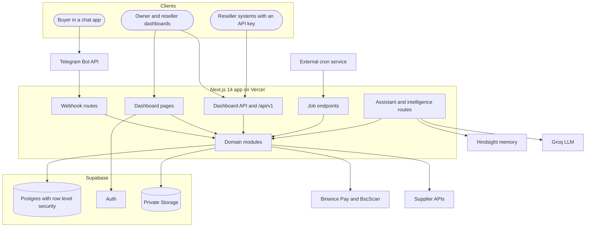
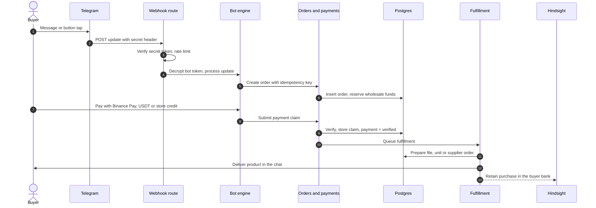
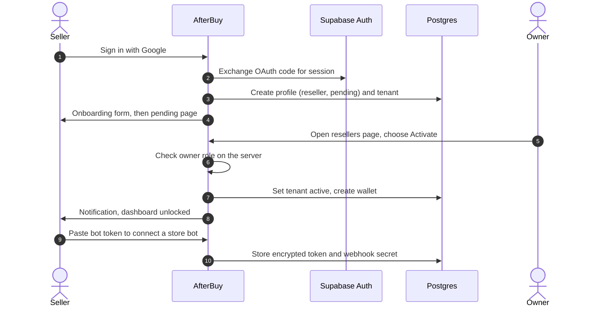
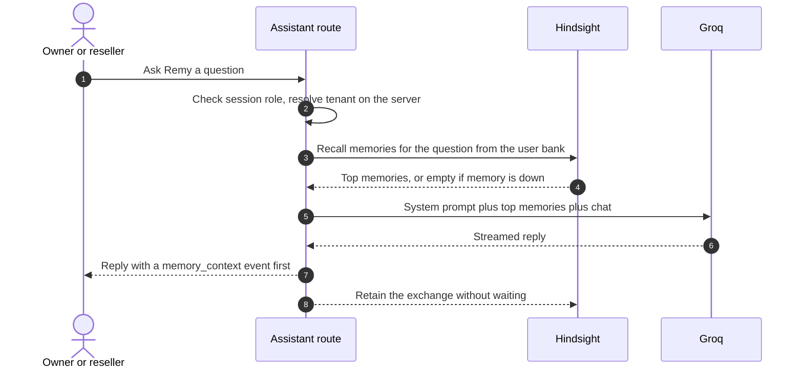
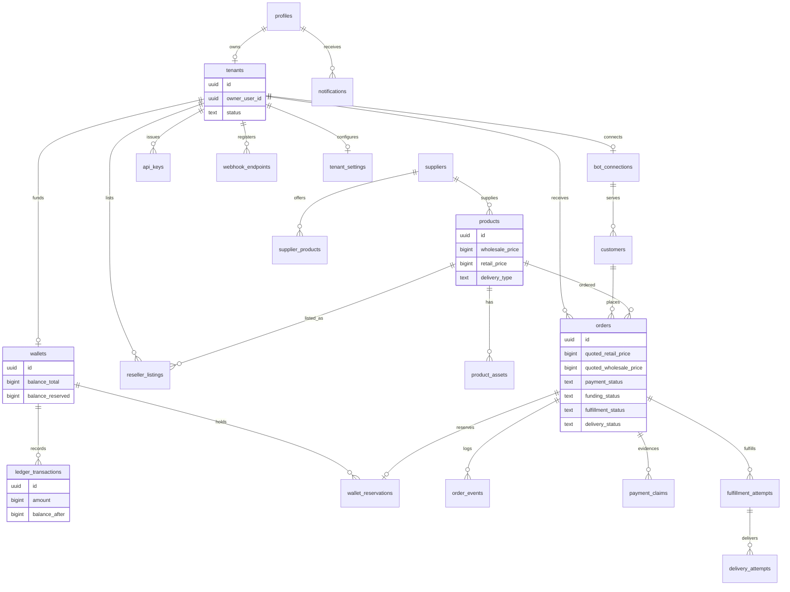
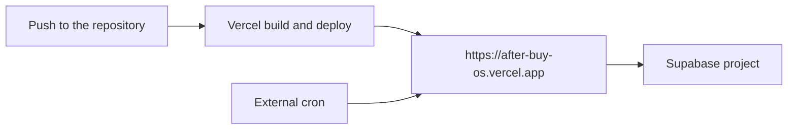

# AfterBuy Architecture

**The store that remembers every buyer.**

Technical reference for AfterBuy. Start with the [README](./README.md) for the product overview.

## Design goals

| Goal | How the design delivers it |
| --- | --- |
| Tenant isolation | Every query is scoped to a tenant that comes from the server session. |
| Correct money | Amounts are integers. Balances cannot go negative. History is append-only. |
| Reliable delivery | Payment, fulfillment and delivery are separate tracks that can be retried. |
| Secrets stay on the server | Tokens are encrypted at rest and never sent to the browser. |
| Memory never blocks a sale | Buyer Memory fails open. Orders continue if memory is down. |

## System overview



Business rules live in `modules/*`. Third-party services sit behind `integrations/*`.

## Request flows

### Buyer purchase through a seller's bot



- Funds for reseller orders are reserved when the order is created and consumed on fulfillment.
- A scheduled job also picks up queued orders, so a missed trigger is retried.
- Memory writes are fire-and-forget. A memory failure never changes the order.

### Seller onboarding and approval



- Middleware holds pending sellers on the onboarding or pending page.
- Only the owner can change a role or status. A database trigger enforces this.
- The owner can also decline a pending seller.

### Remy answering with Buyer Memory



## Module map

### `modules/`

| Folder | Job |
| --- | --- |
| `bots` | Connect and disconnect store bots. Encrypts tokens. Stores customers per bot. |
| `catalog` | Product CRUD, private assets and signed download URLs. |
| `fulfillment` | Turns paid orders into delivered products. Retries and manual completion. |
| `identity` | Profiles, roles and post-login routing. |
| `launch` | Launch-readiness checks for the owner. |
| `notifications` | In-app notifications. Never throws into the caller. |
| `orders` | Create, list and cancel orders. Four-track state machine and event log. |
| `payments` | Binance Pay and USDT claims, verification, owner overrides, store credit and sandbox payments. |
| `platform` | Owner-managed platform settings with encrypted credentials. |
| `pricing` | Server-side pricing and reseller listings. |
| `public-api` | API keys, request authentication and signed outbound webhooks. |
| `supplier` | Sync, review and publish supplier catalog items. |
| `suppliers` | Small supplier registry used by the sandbox. |
| `tenant-settings` | Per-store settings, payment preferences and notification options. |
| `tenants` | Tenant records and status. |
| `wallet` | Wallets, ledger, top-up tokens and reservations through Postgres functions. |

### `integrations/`

| Folder | Job |
| --- | --- |
| `telegram` | grammY bot engine, webhook processing, delivery and product announcements. |
| `binance` | Binance Pay client with a sandbox implementation. |
| `bsc` | BscScan USDT BEP20 verifier with a sandbox implementation. |
| `supplier` | Adapter interface. Picks an adapter from the API key prefix and falls back to a generic one. |
| `prodseller` | HTTP client for one supported supplier API. |

Modules import each other only through `index.ts`.

## Data model

Main tables, from `supabase/migrations`:



Other tables: `invitations`, `topup_tokens`, `audit_log` and `platform_settings`.

## Money rules

- USDT is stored as integer minor units. `1 USDT = 1,000,000`.
- Money columns are `bigint` with checks that block negative values.
- Application code never uses floating point for money. Arithmetic goes through `lib/money.ts`.
- A wallet cannot reserve more than its available balance (`balance_total - balance_reserved`).
- Balance changes run inside Postgres functions, so the check and the write happen in one transaction.
- Ledger rows are append-only. Corrections are new rows.
- Prices are snapshotted on the order at creation. Later catalog edits do not change it.

## Order lifecycle

An order has four independent tracks. Each track has its own legal transitions, and every change adds a row to `order_events`.

| Track | Question it answers | Statuses |
| --- | --- | --- |
| Payment | Has the buyer paid? | `not_required`, `awaiting`, `pending_verification`, `verified`, `failed`, `expired`, `refund_pending`, `refunded`, `disputed` |
| Funding | Is the reseller's wholesale cost covered? | `not_applicable`, `reserved`, `debited`, `released`, `reversal_pending`, `reversed` |
| Fulfillment | Is the product prepared? | `queued`, `manual_pending`, `supplier_pending`, `outcome_unknown`, `ready`, `failed`, `canceled` |
| Delivery | Did it reach the buyer? | `not_ready`, `queued`, `sending`, `sent`, `retry_pending`, `unreachable`, `review_required` |

Delivery types are `file_reusable`, `inventory_unit`, `manual` and `supplier_api`.

## Payments

| Method | How it is handled |
| --- | --- |
| Binance Pay | Checkout is created server-side. The signed webhook or a buyer claim is checked against Binance. |
| USDT BEP20 | The buyer sends a transaction hash. With a BscScan key and a wallet configured, the transfer is checked on-chain. |
| USDT TRC20 | The buyer sees the store's TRC20 address. Automatic checking is on the roadmap. Owners can override payments. |
| Store credit | Debited atomically from the buyer's credit balance. |
| Sandbox | Used when no live method is configured. For evaluation only. |

- Amounts are always compared with the order stored in the database.
- A transaction hash cannot be reused. Every claim is stored with masked evidence.

## Multi-tenancy and security model

| Layer | Control |
| --- | --- |
| Identity | Google sign-in through Supabase Auth. Routes read the verified user, not client claims. |
| Roles | The profile row is the source of truth. `app_metadata` is trusted. `user_metadata` is never trusted. |
| Approval | New sellers start `pending`. The owner activates them. |
| Role guard | A trigger blocks `anon` and `authenticated` roles from changing `role` or `status`. |
| Tenant scope | Tenant ids come from the session. Request bodies never supply them. |
| Database | Row level security is enabled on every table. |
| Secrets | Bot tokens and payment credentials use AES-256-GCM with a random IV. |
| Telegram | The `X-Telegram-Bot-Api-Secret-Token` header is compared in constant time before any work. |
| Webhooks in | Binance Pay signatures are verified before processing. |
| Webhooks out | Payloads are signed with HMAC-SHA256 in `X-AB-Signature`. Delivery retries up to three times. |
| API keys | Format `ab_live_` or `ab_test_`. Only a SHA-256 hash is stored. |
| Rate limits | Public API, Telegram webhook, token redemption, payment checks and invitations. Held in memory per instance. |
| Memory | Bank ids are built on the server from the session. See below. |

### Buyer Memory banks

```text
{prefix}:platform                              platform patterns, owner only
{prefix}:tenant:{tenantId}                     one store
{prefix}:tenant:{tenantId}:customer:{id}       one buyer in one store
```

`{prefix}` is `HINDSIGHT_BANK_PREFIX`. The browser can never choose a bank.

## Background jobs

Job endpoints accept `Authorization: Bearer $CRON_SECRET`, or a signed-in owner for "Run now" buttons. In production a missing secret means the request is refused.

| Endpoint | Interval | Purpose |
| --- | --- | --- |
| `/api/fulfillment/process` | 2 minutes | Fulfill and deliver paid orders. |
| `/api/supplier/reconcile` | 15 minutes | Reconcile pending supplier orders. |
| `/api/supplier/sync` | 30 minutes | Sync the supplier catalog. |
| `/api/bots/health` | 30 minutes | Check every bot webhook. |

An external cron service calls these. See [docs/setup.md](./docs/setup.md).

## Deployment



- The app runs on Vercel. Data, auth and files live in Supabase.
- Environment variable names are listed in the [README](./README.md#environment-variables).
- Set `NEXT_PUBLIC_APP_URL` to the production origin so bot webhooks and invite links are correct.
- Full steps are in [docs/setup.md](./docs/setup.md).
