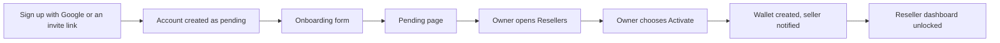

# Demo Guide

**The store that remembers every buyer.**

A 3-minute tour of the live app: https://after-buy-os.vercel.app

## Before you start

- The dashboard is filled with **staging demo data**. It exists for evaluation only.
- Every new account starts as pending and gets access only after the owner approves it. See [How approval works](#how-approval-works-for-a-new-sign-up).
- Most of the tour uses the owner view. The buyer intelligence step needs an approved reseller account.
- Ask the Syrax Phantoms team to approve your account or to walk you through it.

## The 3-minute tour

| Time | Where | What to do | What to look for |
| --- | --- | --- | --- |
| 0:00 | `/owner` dashboard | Read the four cards at the top. | Revenue, Active Resellers with a pending count, Orders Today, Pending Actions. |
| 0:30 | `/owner` dashboard | Scroll to Recent Orders, Revenue by Reseller and Top Products. | Product names on orders, top resellers and top products. |
| 1:00 | `/owner/resellers` | Find the pending reseller. | The Activate action. This is the approval gate. |
| 1:30 | `/owner/intelligence` | Open the Operations Control Tower. | Platform-wide memory view, owner only. |
| 1:50 | `/reseller/intelligence` (reseller account) | Open Store Intelligence, then pick a buyer. | Buyer Memory and the **WHY?** evidence view. |
| 2:15 | `/owner/assistant` | Ask Remy a question about running the platform. | A streamed reply. Memory-powered replies show the memories used. |
| 2:35 | Sidebar | Click **My Telegram Bot**. | Bot status, webhook, last health check and buyer count. |
| 2:50 | `/owner/products` and `/owner/orders` | Open both pages. | Product catalog and the order list with its status tracks. |

If Buyer Memory is not enabled in the environment, the intelligence pages show an empty or degraded state instead of memories.

## What each page shows

| Page | What it shows |
| --- | --- |
| Dashboard | Revenue, orders, pending actions, top resellers and top products. |
| Resellers | Active, pending and suspended sellers, with Activate, Reject and Suspend actions. |
| Intelligence | Buyer Memory: store learning, commerce recovery and per-buyer recall. |
| Remy | The assistant for owners and resellers. |
| My Telegram Bot | Quick view of the connected store bot. |
| Products | Catalog with delivery type, price and stock. |
| Orders | Every order with its payment, fulfillment and delivery status. |

## About the staging demo data

| Item | Amount |
| --- | --- |
| Demo resellers | 5, with one left pending to show the approval flow |
| Demo products | 12 |
| Demo buyers | 60 |
| Demo orders | About 180, spread over 30 days |

- The data exists for evaluation only. It is not real sales.
- Demo products are paused, so they never reach real buyers.
- Revenue, order counts and top lists on the dashboard come from this data.

## How approval works for a new sign-up

1. Sellers can sign up with Google or through an owner's invite link. Either way, a pending reseller account and a store record are created.
2. The seller completes onboarding and waits on the pending page.
3. The owner activates the seller from the Resellers page. The owner can also reject the application.
4. The seller gets a notification and can connect a store bot.

Every new account starts as pending and gets access only after the owner approves it. A database trigger stops anyone changing their own role or status.
