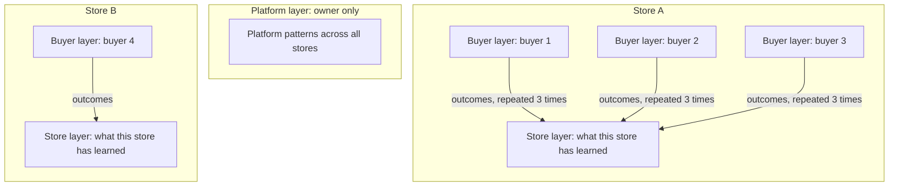

# Innovation

**Most stores forget the buyer after checkout. AfterBuy remembers.**

*The store that remembers every buyer.*

## Buyer Memory in three layers

Store A and Store B never read each other's memory. Only the owner reads the platform layer.

## The core idea

A buyer pays, receives the file and disappears. The seller has no record of what they bought, what they asked or what put them off.

AfterBuy writes that history down and uses it the next time.

## How Buyer Memory works

| Layer | What it holds | Who can read it |
| --- | --- | --- |
| Buyer | Purchases, accepted discounts, questions and outcomes for one buyer in one store. | The seller of that store. |
| Store | Seller instructions, recommendation outcomes and learned patterns for one store. | The seller of that store. |
| Platform | Platform-wide operational patterns. | The platform owner only. |

- Memory is stored in Hindsight by Vectorize, one bank per layer.
- **Each store has its own memory.** The bank id contains the tenant id, and the server builds it from the signed-in session. A bank id from the browser is never accepted.
- `npm run memory:smoke` checks that one store cannot read another store's memory.

### What gets written

- A completed purchase is retained in the buyer bank after fulfillment.
- A discounted purchase is retained as a price preference.
- Remy conversations are retained as support history.
- A recommendation outcome (converted or rejected) is retained in both the buyer bank and the store bank.

### The learning loop

When a recommendation converts or is rejected, `lib/outcome-learning-loop.ts` looks at the store's recent outcomes.

If three different buyers have a similar context and the same outcome, the store gets one learned pattern. A pattern is not promoted twice.

- Repeated buyer behaviour becomes store knowledge.
- Nothing leaves the store. Learned patterns go into the store bank only.
- The loop never throws. A memory failure is logged and ignored.

### Evidence, not guesses

- Recommendations carry the memories they used.
- The **WHY?** view in the buyer panel lists those memories.
- Remy's replies are shaped by the top recalled memories, which are added to the prompt on the server.

### Memory fails open

If Hindsight is off or down, memory calls return empty results and mark the response as degraded. Orders, payments and delivery carry on.

## Before and after

Example questions a seller might ask, in the intelligence pages or to Remy. Illustrative, not recorded results.

| Moment | Without memory | With Buyer Memory |
| --- | --- | --- |
| "What does this buyer usually buy?" | Open the order list and search by hand. | The buyer panel recalls past purchases from the buyer bank. |
| "Should I offer a discount?" | A guess. | Recall shows whether this buyer accepted a lower price before. |
| "What worked last time a payment failed?" | Try to remember. | Commerce recovery recalls past incidents and how they were resolved. |
| "Why this recommendation?" | No explanation. | The WHY? view shows the memories behind it. |
| "Which pitch converts in my store?" | Not tracked. | Repeated outcomes become a learned store pattern. |

## Automated after-sale pipeline

After a buyer pays, AfterBuy runs the rest of the sale.

1. The payment is checked against the order amount.
2. The order moves into a fulfillment queue.
3. The product is prepared from a stored file, a stock unit, a supplier order or a manual step.
4. The product is delivered in the chat. Failed deliveries retry.
5. The seller is notified and Buyer Memory records the purchase.

**Why it matters to a solo seller:** the work that used to fill the evening happens on its own. Exceptions still reach the seller, such as a manual order or an unreachable buyer.

## Reseller network

- The owner publishes products, either their own files or items imported from a supplier API.
- Each reseller connects their own store bot and lists products at their own retail price.
- The reseller pays the wholesale price from a prepaid USDT wallet. They keep the margin.
- Every sale is tracked per reseller, so the owner sees who sells what.

One supplier can serve many seller stores, and each store keeps its own buyers and its own memory.

## Why this combination is new

Generic store builders are built around a web storefront. AfterBuy puts these pieces together in one product:

| Piece | What it adds |
| --- | --- |
| Chat-native selling | The shop lives where the buyer already talks. |
| Automated after-sale pipeline | Payment check, delivery and tracking without manual steps. |
| Per-store Buyer Memory | Each seller builds their own record of buyers and what works. |
| Reseller network | One catalog, many seller stores, each at its own margin. |

Each piece exists elsewhere on its own. AfterBuy combines them and keeps memory private to each store.
