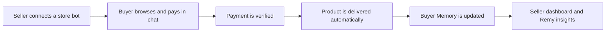
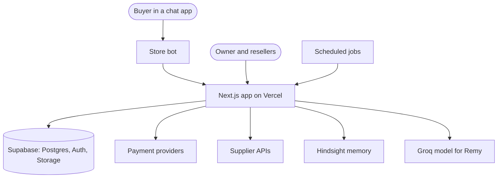

# AfterBuy

**The store that remembers every buyer.**


[Live App](https://after-buy-os.vercel.app) · [Architecture](./ARCHITECTURE.md) · [Innovation](./INNOVATION.md) · [Business](./BUSINESS.md) · [Demo Guide](./DEMO.md)

> **60-second summary for judges**
>
> - **Problem:** Small digital sellers run their shop by hand inside chat apps and forget buyers after the sale.
> - **Solution:** Launch a branded store bot, automate payment checks and delivery, and keep a memory of every buyer.
> - **Innovation:** Buyer Memory keeps a separate memory per buyer, per store and per platform, and Remy uses it.
> - **Who pays:** Sellers, through a planned monthly subscription plus a small margin per sale.
> - **Live link:** https://after-buy-os.vercel.app

---

## In one sentence

AfterBuy is a commerce platform that lets digital sellers run a store inside chat apps, deliver orders automatically, and remember every buyer. Telegram is the first supported channel.

## By the numbers

| API routes | Database tables | Passing tests | Payment methods |
| :---: | :---: | :---: | :---: |
| 110 | 25 | 176 | 4 |

Counted from `app/api`, `supabase/migrations` and `npm run test`. The four payment methods are Binance Pay, USDT on BEP20, USDT on TRC20 and store credit.

## The problem

- Small digital sellers run their shop by hand inside chat apps.
- They forget customers after the sale. There is no record of what a buyer bought or asked.
- They verify payments and deliver products manually, order by order.
- One person does everything, so the shop cannot grow past that person.

## The solution

| Pillar | What it means |
| --- | --- |
| **Launch** | Connect your own branded store bot in about a minute. Paste a bot token, set your prices, and sell. |
| **Automate** | After every sale AfterBuy checks the payment, delivers the product and tracks the order. |
| **Remember** | Buyer Memory keeps what each buyer bought and asked. Remy, the assistant, uses it. |

## How it works



## Key features

### Owner

| Feature | What it does |
| --- | --- |
| Owner dashboard | Revenue, orders today, pending actions, top resellers, top products and platform health. |
| Reseller approval flow | New sign-ups wait as pending until the owner activates or declines them. |
| Products and supplier API | Own products with private files, or products imported from a supplier API and reviewed before publishing. |
| Wallets and top-up tokens | Single-use 12-digit tokens load credit into reseller wallets. |
| Payments monitor | Review payment claims and override a payment with a written reason. |
| Fulfillment queue | See paid orders, retry delivery, or complete manual orders. |
| Operations Control Tower | Platform-wide Buyer Memory view for the owner only. |
| Remy assistant | Chat help for running the platform. |

### Reseller

| Feature | What it does |
| --- | --- |
| Own store bot | Paste a bot token and the bot goes live. The token is encrypted. |
| "My Telegram Bot" quick panel | Sidebar panel with bot status, webhook, last health check and buyer count. |
| Own pricing | Set retail prices on top of the owner's wholesale price. |
| Orders, deliveries, buyers | Track every order and buyer. |
| Wallet and ledger | Prepaid USDT wallet with a full transaction history. |
| Buyer Memory pages | Store intelligence, per-buyer recall with a WHY? evidence view, and commerce recovery. |
| Public REST API v1 | API keys, idempotent order creation and signed outbound webhooks. |
| Notifications | In-app alerts for orders, wallet changes and account status. |

### Buyer

| Feature | What it does |
| --- | --- |
| Shop in chat | Browse products, pick a quantity and order inside the bot. |
| Pay your way | Binance Pay, USDT on BEP20, USDT on TRC20 or store credit. |
| Delivery in chat | The product arrives in the same conversation after payment. |
| Order history and support | Check orders and reach the store from the bot. |

> **Payment note:** Binance Pay and BEP20 are checked automatically when live credentials are configured. Without them the platform uses a sandbox. TRC20 shows the store's address to the buyer. Automatic TRC20 checking is on the roadmap.

## What makes it different

- **Memory is the product.** Most stores forget the buyer after checkout. AfterBuy keeps Buyer Memory in three layers: buyer, store and platform.
- **Each store has its own memory.** Banks are resolved on the server from the signed-in session, so one store never reads another store's buyers.
- **Memory learns.** When three different buyers share the same outcome, the store gets a learned pattern.

Read more in [INNOVATION.md](./INNOVATION.md).

### Generic store builders vs AfterBuy

| | Generic store builders | AfterBuy |
| --- | :---: | :---: |
| Sells inside chat apps | — | ✓ |
| Remembers each buyer | — | ✓ |
| Delivers in chat automatically after payment | — | ✓ |
| Reseller network (one supplier, many stores) | — | ✓ |
| Go live from a bot token, no site to build | — | ✓ |

Generic store builders here means typical web-first storefront tools in their default setup.

## Try it in 2 minutes

1. Open https://after-buy-os.vercel.app.
2. Sign in with Google.
3. New accounts wait for owner approval by design. You will see the onboarding step and then the pending page.
4. Ask the team to approve your account, or follow the guided tour in [DEMO.md](./DEMO.md).
5. Once approved, look at the dashboard, the intelligence pages, Remy and the "My Telegram Bot" panel.

The dashboard is filled with **staging demo data**. It exists for evaluation only.

## Tech stack

| Layer | Technology | Why |
| --- | --- | --- |
| App | Next.js 14 (App Router), React 18, TypeScript strict | One codebase for dashboards and API routes. |
| Styling | Tailwind CSS, GSAP, Framer Motion, three.js | Themeable UI and the landing page. |
| Data and auth | Supabase (Postgres, Auth, private Storage) | Row level security and Google sign-in. |
| Chat channel | grammY | Telegram Bot API handlers. |
| Memory | Hindsight by Vectorize | Separate memory banks per buyer, store and platform. |
| Assistant model | Groq (`openai/gpt-oss-20b`) | Fast streamed replies for Remy. |
| Validation | Zod | Every request body is validated. |
| Tests | Vitest | Unit tests with fake external services. |
| Hosting | Vercel and an external cron service | Serverless app plus scheduled jobs. |

## Architecture at a glance



Full diagrams and flows are in [ARCHITECTURE.md](./ARCHITECTURE.md).

## Run it locally

You need Node.js 20 or later and a Supabase project.

```bash
git clone https://github.com/Kush-u/AfterBuy-OS.git
cd AfterBuy-OS
npm install
cp .env.example .env.local   # then fill in your own values
```

1. Open the Supabase SQL editor.
2. Run every file in `supabase/migrations` in numeric order. Number 0022 is intentionally absent.
3. Start the app:

```bash
npm run dev
```

Open http://localhost:3000. Full setup, including Google sign-in and the first owner account, is in [docs/setup.md](./docs/setup.md).

### Environment variables

Names and purpose only. Never commit `.env.local`.

| Variable | Purpose |
| --- | --- |
| `NEXT_PUBLIC_SUPABASE_URL` | Supabase project URL. |
| `NEXT_PUBLIC_SUPABASE_ANON_KEY` | Browser-safe Supabase key, protected by row level security. |
| `SUPABASE_SERVICE_ROLE_KEY` | Server-only Supabase key. |
| `NEXT_PUBLIC_APP_URL` | Public origin of the app. Used for bot webhooks and invite links. |
| `BOT_TOKEN_ENCRYPTION_KEY` | 32-byte hex key for AES-256-GCM encryption of tokens and secrets. |
| `CRON_SECRET` | Shared secret for scheduled job endpoints. |
| `GROQ_API_KEY` | Enables Remy. |
| `HINDSIGHT_API_KEY` | Enables Buyer Memory. |
| `HINDSIGHT_API_URL` | Hindsight API base URL. |
| `HINDSIGHT_ENABLED` | Set to `true` to turn Buyer Memory on. |
| `HINDSIGHT_BANK_PREFIX` | Namespace for memory banks. |
| `BSCSCAN_API_KEY` | Optional. Enables on-chain BEP20 checks. |
| `ACTIVE_SUPPLIER` | Optional. Selects the supplier connection. |
| `SUPPLIER_1_API_KEY` | Optional. Supplier API key. |
| `SUPPLIER_1_BASE_URL` | Optional. Supplier API base URL. |

## Project structure

```text
app/            Pages and API routes: landing, auth, dashboards, /api, /api/v1
components/     Shared UI, landing page, intelligence and assistant panels
modules/        Domain logic: orders, wallet, payments, catalog, bots, fulfillment, identity
integrations/   Telegram, Binance Pay, BSC, supplier adapters
lib/            Money, tokens, encryption, memory, logging, helpers
supabase/       SQL migrations and a small development seed
tests/          Unit tests and fake external services
docs/           Setup guide, cron guide, decisions and integration notes
```

## Security

- Bot tokens and payment credentials are encrypted with AES-256-GCM.
- Telegram webhooks check a per-bot secret token before doing any work.
- Binance Pay webhooks verify their signature before processing.
- Postgres row level security is on for every table. Server code uses the service role only on the server.
- A database trigger blocks users from changing their own role or status.
- Owner checks run on the server. New sellers need owner approval.
- Outbound webhooks are signed with HMAC-SHA256 (`X-AB-Signature`).
- Rate limiting covers the public API, Telegram webhooks, token redemption, payment checks and invitations. Limits are held in memory per instance.
- Money is stored as integer minor units. The application never updates or deletes ledger rows.

## Testing

176 tests across 19 files pass today. Tests use fake Supabase, Binance and supplier clients. They never call real services.

```bash
npm run type-check
npm run lint
npm run test
npm run build
```

## Roadmap

- More chat channels, such as WhatsApp and Instagram.
- Automatic on-chain verification for live BEP20 and TRC20 payments.
- Hardening of order and wallet reservation edge cases.
- A mobile app for sellers.
- Analytics exports.
- Seller billing for the planned subscription.

## FAQ for judges

**Is the data real?**
No. The dashboard shows staging demo data for evaluation. Demo products are paused so they never reach real buyers.

**How does memory stay private per store?**
Each store has its own memory banks. The server builds the bank id from the signed-in session. It never accepts a bank id from the browser.

**What happens after a buyer pays?**
The payment is verified. The order moves into a fulfillment queue and the product is delivered in the chat. Buyer Memory then records the purchase.

**How do new sellers join?**
They sign in with Google, finish onboarding and wait as pending. The owner approves them from the resellers page.

**What's next?**
More chat channels, automatic TRC20 checking, hardening of order and wallet edge cases, and a seller mobile app.

## Team

**Syrax Phantoms**

| Member | Role |
| --- | --- |
| Kushal Chaudhari | Team lead, full-stack and AI |
| Prince Tiwari | Testing and QA |
| Ishita Sharma | Data and demo |
| Dhanavath Gayathri | Research, docs and pitch |

## License

[MIT](./LICENSE)
