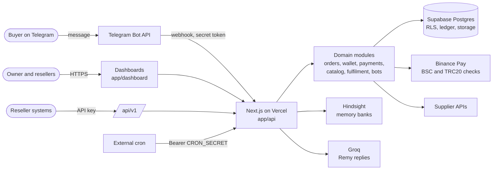

# AfterBuy

**The Telegram store that remembers every buyer.**

AfterBuy is a multi-tenant platform for selling digital products through Telegram bots. A platform owner curates a catalogue, resellers connect their own bots and sell it on, and every buyer is remembered: what they bought, what they asked, what put them off. Remy, the built-in assistant, uses that memory (Buyer Memory) so the next reply starts where the last one ended.

Production URL placeholder: `https://afterbuy.vercel.app`

---

## Who it is for

| Role | What they do in AfterBuy |
| --- | --- |
| **Platform owner** | Runs the catalogue, invites resellers, tops up wallets with tokens, connects suppliers, watches payments and bot health. |
| **Reseller** | Connects a Telegram bot in minutes, sets their own prices, and sees orders, buyers and wallet balance. |
| **Buyer** | Shops inside Telegram, pays by wallet, Binance Pay or USDT, and gets the product delivered in the chat. |

## Features

**For owners**
- Master product catalogue with private file storage and signed delivery links
- Supplier integrations with automatic adapter selection from the API key prefix (ProdSeller, Canboso, generic)
- Reseller invitations, approval, suspension and wallet top-up tokens
- Payment monitoring and manual overrides, fulfilment queue, bot health view
- Platform-wide memory and an operations control tower

**For resellers**
- Paste a BotFather token and the bot is live; the token is encrypted at rest
- Own pricing per product, on top of the owner's wholesale price
- Orders, deliveries, buyers, deposits and a USDT wallet with a full ledger
- Public REST API (`/api/v1`) with API keys, idempotency keys and signed webhooks
- Remy, the assistant, with store-level memory

**For buyers (inside Telegram)**
- Browse the shop, pick a quantity, pay and receive the product in the same chat
- Payment by wallet balance, Binance Pay, USDT on BEP20 or USDT on TRC20
- Order history, wallet, referrals and support commands

**Buyer Memory**
- Three memory layers: platform, store, and individual buyer
- Every store has its own memory bank, resolved on the server and never taken from the browser
- A **WHY?** view shows which memories Remy used for a suggestion
- Memory fails open: if the memory service is down, orders and replies carry on

## Architecture



How a purchase moves:

1. The buyer messages the bot. Telegram calls `POST /api/webhooks/telegram/[botId]`.
2. The route checks the `X-Telegram-Bot-Api-Secret-Token` header before doing anything else, then resolves the store from the bot record.
3. The order is created and paid by wallet, Binance Pay or a USDT claim that is verified on-chain.
4. A cron-driven fulfilment job delivers the product, from a stored file, a manual step, or a supplier API.
5. The completed purchase is written to that buyer's memory bank so the next conversation can recall it.

More detail is in [ARCHITECTURE.md](./ARCHITECTURE.md).

## Tech stack

| Layer | Technology |
| --- | --- |
| Framework | Next.js 14 (App Router), React 18, TypeScript (strict) |
| Styling and motion | Tailwind CSS, CSS custom properties for dark and light themes, GSAP, Framer Motion, three.js |
| Data and auth | Supabase (Postgres, Row Level Security, Auth, private Storage) |
| Telegram | grammY |
| Memory | Hindsight by Vectorize |
| Assistant model | Groq (`openai/gpt-oss-20b`) |
| Validation | Zod |
| Tests | Vitest |
| Hosting | Vercel, with an external cron service |

## Getting started

### Prerequisites

- Node.js 20 or later
- A Supabase project
- A Telegram bot token from [@BotFather](https://t.me/BotFather) for testing
- Optional: Hindsight and Groq keys for Buyer Memory and Remy

### Setup

```bash
# 1. Clone and install (.npmrc already sets legacy-peer-deps for grammY)
git clone https://github.com/Kush-u/AfterBuy.git
cd AfterBuy
npm install

# 2. Configure the environment
cp .env.example .env.local
# fill in the values described below

# 3. Apply the database migrations
# Run every file in supabase/migrations/ in numeric order
# (Supabase SQL Editor or the Supabase CLI). 0022 is intentionally absent.

# 4. Start the dev server
npm run dev
```

Open <http://localhost:3000>. Sign in with Google, then set `profiles.role` to `owner` for your own row in Supabase. There is no public sign-up; resellers join through owner invitations.

Optional steps:

```bash
npm run memory:seed    # seed demo Buyer Memory data
npm run memory:smoke   # verify that memory banks stay isolated
npm run tunnel         # expose localhost over HTTPS (ngrok) so Telegram can reach webhooks
```

See [docs/local-development.md](./docs/local-development.md) for the tunnel workflow.

### Environment variables

Copy `.env.example` to `.env.local`. Never commit `.env.local`.

| Variable | Purpose |
| --- | --- |
| `NEXT_PUBLIC_SUPABASE_URL` | Supabase project URL |
| `NEXT_PUBLIC_SUPABASE_ANON_KEY` | Supabase anon key (browser-safe, protected by RLS) |
| `SUPABASE_SERVICE_ROLE_KEY` | Supabase service role key. Server only, never exposed to the browser |
| `NEXT_PUBLIC_APP_URL` | Public origin of the app, for example `https://afterbuy.vercel.app`. Used for webhooks and invite links |
| `BOT_TOKEN_ENCRYPTION_KEY` | 32-byte hex key used for AES-256-GCM encryption of bot tokens |
| `CRON_SECRET` | Shared secret for cron endpoints |
| `GROQ_API_KEY` | Groq key for Remy. Server only |
| `HINDSIGHT_API_KEY` | Hindsight key for Buyer Memory. Server only |
| `HINDSIGHT_API_URL` | Hindsight API base URL |
| `HINDSIGHT_ENABLED` | Set to `true` to turn Buyer Memory on |
| `HINDSIGHT_BANK_PREFIX` | Namespace for memory banks, `afterbuy-prod` by default |
| `BSCSCAN_API_KEY` | Optional. Verifies USDT BEP20 payments |
| `ACTIVE_SUPPLIER` | Optional. Selects the active supplier |
| `SUPPLIER_1_API_KEY` | Optional. Supplier API key |
| `SUPPLIER_1_BASE_URL` | Optional. Supplier API base URL |

### Scheduled jobs

Four endpoints must be called on a schedule with `Authorization: Bearer $CRON_SECRET`. Setup steps are in [docs/cron-setup.md](./docs/cron-setup.md).

| Endpoint | Every | Purpose |
| --- | --- | --- |
| `/api/fulfillment/process` | 2 minutes | Deliver paid orders |
| `/api/supplier/reconcile` | 15 minutes | Reconcile orders with the supplier |
| `/api/supplier/sync` | 30 minutes | Sync the supplier catalogue |
| `/api/bots/health` | 30 minutes | Check every bot webhook |

## Scripts

| Command | What it does |
| --- | --- |
| `npm run dev` | Start the development server |
| `npm run build` | Production build |
| `npm run type-check` | TypeScript strict check |
| `npm run lint` | ESLint through `next lint` |
| `npm run test` | Run the Vitest suite |

Every change should pass `type-check`, `lint`, `test` and `build`.

## Project layout

```text
app/            Routes: landing, auth, owner and reseller dashboards, API
components/     Shared UI, landing page, intelligence panels
modules/        Domain logic: orders, wallet, payments, catalog, bots, identity ...
integrations/   Telegram, Binance, BSC, supplier adapters
lib/            Money, tokens, encryption, hindsight, logger, helpers
jobs/           Scheduled job handlers
shaders/        GLSL used by the landing page
supabase/       SQL migrations and seed data
tests/          Unit tests and fakes for external services
docs/           Plans, runbooks and integration notes
```

## Security

- Bot tokens are encrypted with AES-256-GCM and only decrypted for the length of a request.
- Telegram and Binance webhooks verify their signature or secret before any processing.
- All money is stored as `bigint` minor units (1 USDT = 1,000,000). Ledger rows are never updated or deleted.
- Row Level Security is enabled on tenant data, and tenant and role are always derived on the server.
- Secrets live in server-only environment variables and are never logged.

## Documentation

- [ARCHITECTURE.md](./ARCHITECTURE.md): system design
- [docs/master-plan.md](./docs/master-plan.md): product and engineering plan
- [docs/decisions.md](./docs/decisions.md): design decisions
- [docs/cron-setup.md](./docs/cron-setup.md): scheduled jobs
- [docs/secret-rotation.md](./docs/secret-rotation.md): rotating secrets
- [docs/integrations](./docs/integrations): Binance and BSC notes

## License

[MIT](./LICENSE)
